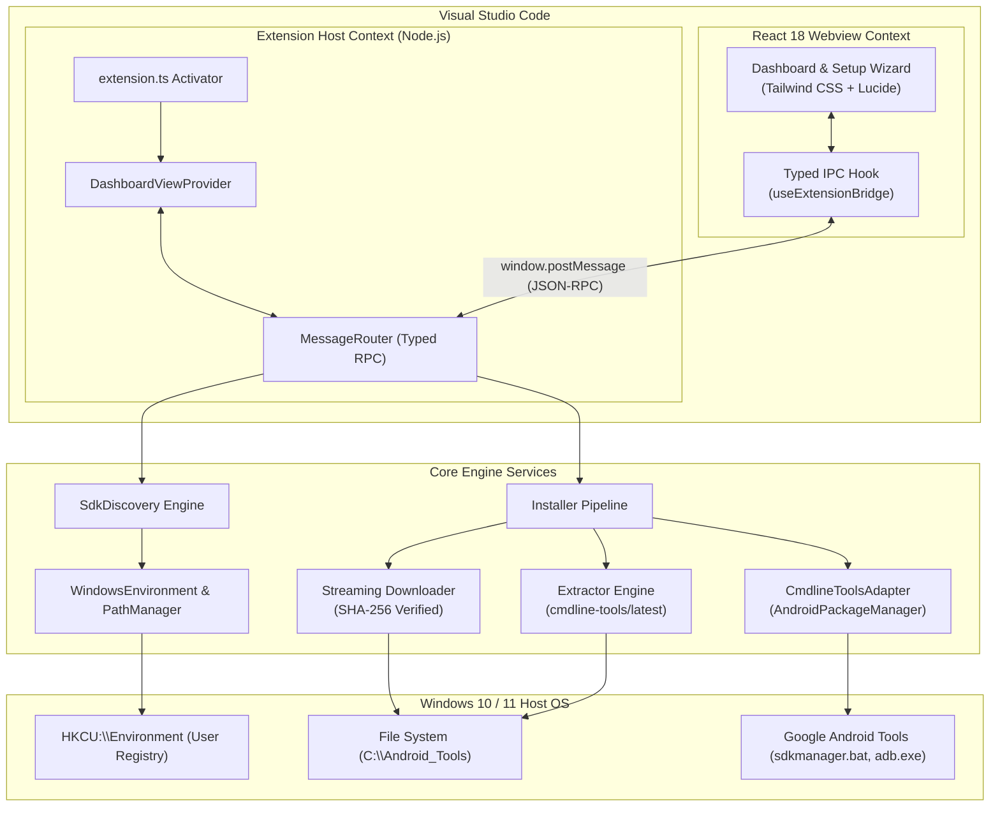

# Android Dev Tools for Visual Studio Code

[](https://marketplace.visualstudio.com)
[](./LICENSE)
[](https://www.typescriptlang.org/)
[](https://react.dev/)
[](https://microsoft.com)
[](./tests)

Automate Android SDK installation, environment variable configuration, Java Development Kit (JDK) management, and system diagnostics directly inside Visual Studio Code. Built Windows-first with zero requirement for full Android Studio installations.

---

## Overview

Setting up a functional Android development environment on Windows has traditionally been an error-prone, multi-step process requiring developers to manually download command-line tools, manage nested directory trees, configure environment variables, accept license agreements in terminal prompts, and resolve Java version mismatches.

**Android Dev Tools** streamlines this entire workflow into a unified Visual Studio Code experience:
- **No Heavy IDE Bloat:** Works directly with official Google Android command-line tools and certified OpenJDK headless runtimes.
- **Zero Administrative Elevation:** Configures user-level environment variables (`HKCU:\Environment`) without triggering Windows UAC prompts.
- **Surgical PATH Updates:** Deduplicates and appends required binary paths without clobbering existing developer tooling.
- **Automated License Agreement:** Directly establishes certified Google SDK license signatures without interactive console hangs.
- **Instant System Diagnostics:** Probes existing installations in under 10ms via direct package property inspection.

---

## Key Features

### 1. Guided Setup Wizard
- **Multi-step workflow:** Guides users through Directory Selection, Profile Choice, Java Runtime selection, and Live Progress execution.
- **Installation Profiles:**
  - **Physical Device Profile (~2.5 GB):** Command-line tools, Platform Tools (ADB & Fastboot), Build Tools, and compile platform.
  - **Full Setup Profile (~12 GB):** Adds Android Emulator binary and x86_64 system images for desktop virtualization.
- **Pre-flight Drive Validation:** Automatically inspects target disk capacity and folder write permissions prior to downloading.

### 2. Dual-View Experience
- **Compact Sidebar View:** A lightweight summary widget in the Activity Bar showing immediate environment status, quick metrics, and a single-click launch button.
- **Expansive Main Editor Dashboard:** A full-width management suite with tabs for Overview, Setup Wizard, SDK Packages catalog, JDK Manager, Diagnostics Hub, and Settings.
- **Focused Workspace Mode:** Launching the main dashboard automatically minimizes the right-side auxiliary panel and bottom terminal panel for an uncluttered setup view.

### 3. Sub-10ms Environment Discovery
- Inspects `ANDROID_HOME`, `ANDROID_SDK_ROOT`, `JAVA_HOME`, and Windows Registry hives in parallel.
- Queries `adb.exe` version strings and checks PATH accessibility.
- Reads package revisions directly from local `source.properties` key-value files, bypassing slow JVM boot times.

### 4. Interactive Diagnostics and One-Click Auto-Repair
- Flags broken paths, missing binaries, unaccepted licenses, and incompatible Java versions.
- Distinguishes between critical errors, configuration warnings, and informational notices.
- Provides one-click "Fix Automatically" actions for common misconfigurations like missing PATH entries or pending licenses.

---

## System Architecture



---

## Directory Layout of Managed Tools

When configured to a managed root (for example, `C:\Android_Tools`), the extension maintains Google's canonical folder structure:

```
C:\Android_Tools\
├── sdk\                           # Designated ANDROID_HOME root
│   ├── cmdline-tools\
│   │   └── latest\                # Nested structure required by sdkmanager
│   │       ├── bin\               # sdkmanager.bat, avdmanager.bat
│   │       ├── lib\
│   │       └── source.properties
│   ├── platform-tools\            # adb.exe, fastboot.exe
│   ├── build-tools\               # e.g., 34.0.0\, 35.0.0\
│   ├── platforms\                 # e.g., android-34\, android-35\
│   ├── emulator\                  # emulator.exe
│   └── licenses\                  # Accepted license signature files
├── jdk\
│   └── managed\                   # Eclipse Temurin OpenJDK 17 LTS
├── downloads\                     # Temporary holding directory for zip archives
├── logs\                          # Installation transcripts and session logs
└── config\                        # Manifests and settings
    ├── settings.json
    └── installation.json
```

---

## Technology Stack

| Layer | Technology | Purpose |
|---|---|---|
| **Runtime** | Node.js (v18+) | Extension Host system operations and child process execution |
| **Language** | TypeScript 5.4 | Strict end-to-end type safety |
| **Editor API** | VS Code Extension API | Commands, Activity Bar, Webviews, and GlobalStorage |
| **Frontend** | React 18.3 + Lucide Icons | Responsive dashboard and setup wizard interface |
| **Styling** | Tailwind CSS 3.4 | Native theme integration matching VS Code color variables |
| **Webview Bundler** | Vite 5.4 | High-speed production bundling of React UI assets |
| **Host Bundler** | esbuild 0.20 | Single-file Extension Host packaging (`dist/extension.js`) |
| **Testing** | Vitest 1.6 | Fast unit and integration test runner |

---

## Getting Started

### Prerequisites
- Windows 10 or Windows 11 (64-bit)
- Visual Studio Code version 1.85.0 or higher
- Node.js 18.x or 20.x (for building from source)

### Running from Source in Development
1. Clone this repository:
   ```bash
   git clone https://github.com/your-username/android-dev-tool.git
   cd android-dev-tool
   ```
2. Install dependencies:
   ```bash
   npm install
   ```
3. Compile both Extension Host and Webview:
   ```bash
   npm run build
   ```
4. Press **`F5`** in Visual Studio Code (select **`Run Extension`** in the Debug panel).
5. In the newly opened `[Extension Development Host]` window:
   - Click the **Android Dev Tools** icon in the Activity Bar.
   - Click **"Start Setup Now"** or **"Open Full Dashboard"** to begin!

---

## Available NPM Scripts

| Command | Action |
|---|---|
| `npm run build` | Compiles the Extension Host via `esbuild` and the UI via `vite`. |
| `npm run build:extension` | Compiles only the Extension Host backend to `dist/extension.js`. |
| `npm run build:ui` | Bundles only the React Webview application to `dist/ui/`. |
| `npm run watch` | Runs concurrent watchers for both Extension Host and Webview. |
| `npm test` | Executes all Vitest unit and integration test suites. |

---

## Java and Android Gradle Plugin Compatibility

Modern Android applications require specific Java versions based on the Android Gradle Plugin (AGP) version used by the project:

| AGP Version Range | Minimum Java Version | Default Recommended JDK |
|---|---|---|
| **AGP 8.5.x to 8.8+** | Java 17 | **OpenJDK 17 LTS (or 21)** |
| **AGP 8.0.x to 8.4.x** | Java 17 | **OpenJDK 17 LTS** |
| **AGP 7.0.x to 7.4.x** | Java 11 | **OpenJDK 11** |
| **AGP 4.x (Legacy)** | Java 8 | **Java 8** |

Android Dev Tools verifies that your active `JAVA_HOME` satisfies these criteria, and provides one-click installation of Eclipse Temurin OpenJDK 17 LTS when needed.

---

## Security and Safety Guardrails

- **Zero Command Injection:** All external binaries (`adb.exe`, `sdkmanager.bat`, `powershell.exe`) are executed with explicit argument arrays without shell interpolation.
- **Cryptographic Verification:** Downloaded Google archive files are validated against official SHA-256 checksums before decompression.
- **Non-Destructive PATH Modification:** The path manager parses and deduplicates PATH entries, appending only missing directories without re-ordering or truncating existing variables.
- **Strict Content Security Policy:** The Webview disallows arbitrary remote scripts and requires cryptographically generated nonces for local script execution.

---

## Project Roadmap

- **Phase 1: Environment Manager (Current Scope):**
  - SDK discovery and non-destructive detection.
  - Resumable streaming downloads and canonical extraction.
  - User-scope `ANDROID_HOME` and `PATH` configuration.
  - Managed OpenJDK 17 installation and validation.
  - Health checks and one-click auto-repair diagnostics.
- **Phase 2: Device Manager (Upcoming):**
  - Real-time ADB device detection and wireless ADB pairing.
  - Android Virtual Device (AVD) emulator creation and lifecycle controls.
  - APK drag-and-drop installation.
- **Phase 3: Testing Studio (Future):**
  - Embedded low-latency Android display mirroring inside VS Code.
  - Real-time Logcat stream filtering and crash monitoring.
  - Autonomous AI-agent testing integrations.

---

## Contributing

Contributions, bug reports, and feature requests are welcome!
1. Fork the repository.
2. Create your feature branch (`git checkout -b feature/amazing-feature`).
3. Commit your changes (`git commit -m 'feat: add amazing feature'`).
4. Ensure all tests pass (`npm test` and `npm run build`).
5. Push to the branch (`git push origin feature/amazing-feature`).
6. Open a Pull Request.

---

## License

This project is licensed under the MIT License. See the [LICENSE](./LICENSE) file for details.
