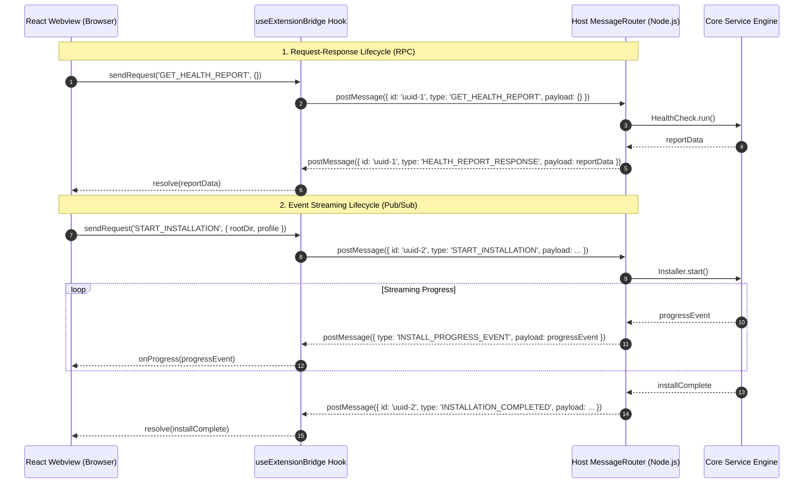

# IPC & Webview Messaging Specification

This document defines the inter-process communication (IPC) protocol between the **Visual Studio Code Extension Host** (Node.js runtime) and the **React Webview Dashboard** (Browser sandbox runtime).

---

## 1. IPC Architecture & Communication Model

VS Code Webviews run inside an isolated iframe/browser environment with no access to Node.js APIs. Communication occurs strictly via asynchronous message passing:
- **Webview to Host:** `vscode.postMessage({ id, type, payload })`
- **Host to Webview:** `webview.postMessage({ id, type, payload, error })`



---

## 2. Standard Message Envelope

Every message sent across the bridge conforms to the following TypeScript interface:

```typescript
export interface BridgeMessage<T = unknown> {
  /**
   * Unique UUID for correlating request/response pairs.
   * Optional for unprompted push events from the Host.
   */
  id?: string;

  /**
   * Strongly typed message identifier.
   */
  type: string;

  /**
   * Message data payload.
   */
  payload?: T;

  /**
   * Error payload populated if a request fails.
   */
  error?: BridgeError;
}

export interface BridgeError {
  code: string;
  message: string;
  details?: unknown;
}
```

---

## 3. Message Catalog: Webview to Extension Host (Client Requests)

| Message Type (`type`) | Payload Interface | Description |
|---|---|---|
| `UI_READY` | `void` | Dispatched by Webview upon mount to signal readiness to receive initial data. |
| `GET_HEALTH_REPORT` | `void` | Requests a fresh evaluation of installed tools, environment variables, and diagnostics. |
| `GET_SETTINGS` | `void` | Requests currently persisted user preferences and configurations. |
| `SAVE_SETTINGS` | `SettingsConfig` | Persists updated user preferences to `globalStorageUri`. |
| `SELECT_DIRECTORY` | `{ title?: string; defaultUri?: string }` | Opens VS Code's native folder picker dialog to select an installation root. |
| `START_INSTALLATION` | `StartInstallPayload` | Triggers the complete installation sequence for a chosen profile and root directory. |
| `CANCEL_INSTALLATION` | `void` | Requests graceful cancellation and cleanup of an ongoing installation. |
| `GET_PACKAGES` | `{ forceRefresh?: boolean }` | Requests package catalog from `sdkmanager` (installed and available). |
| `INSTALL_PACKAGES` | `{ packageIds: string[] }` | Requests installation of specific SDK packages by ID. |
| `ACCEPT_LICENSES` | `void` | Triggers automated or explicit acceptance of Android SDK licenses. |
| `RUN_AUTO_REPAIR` | `{ issueId: string }` | Requests execution of an automated repair action for a specific diagnostic issue. |
| `SET_JDK_CONFIG` | `JdkConfigPayload` | Updates JDK strategy (`detect`, `managed`, `manual`) and path. |

---

## 4. Message Catalog: Extension Host to Webview (Host Responses & Events)

| Message Type (`type`) | Payload Interface | Description |
|---|---|---|
| `HEALTH_REPORT` | `SystemHealthReport` | Complete diagnostic and detection snapshot of the Android development environment. |
| `SETTINGS_DATA` | `SettingsConfig` | Active extension configuration payload. |
| `DIRECTORY_SELECTED` | `{ selectedPath: string \| null }` | The path returned from the native folder picker dialog (or null if canceled). |
| `INSTALL_PROGRESS_EVENT` | `InstallProgress` | Streaming progress notification containing current phase, bytes, percentage, and text. |
| `INSTALL_COMPLETED` | `InstallResult` | Final result after an installation sequence completes successfully. |
| `INSTALL_FAILED` | `InstallFailurePayload` | Dispatched when an installation halts due to an error, with recovery recommendations. |
| `PACKAGE_CATALOG` | `PackageCatalog` | Categorized listing of installed and available Android packages. |
| `AUTO_REPAIR_RESULT` | `{ issueId: string; success: boolean; message: string }` | Outcome of an automated repair attempt. |

---

## 5. Core Data Payload Contracts (`src/shared/types.ts`)

```typescript
// --- System Health & Diagnostics ---

export type HealthStatus = 'ready' | 'warning' | 'error';

export interface ComponentHealth {
  id: 'cmdline-tools' | 'platform-tools' | 'build-tools' | 'platform' | 'emulator';
  name: string;
  isInstalled: boolean;
  version?: string;
  path?: string;
  statusText: string;
}

export interface SystemHealthReport {
  overallStatus: HealthStatus;
  sdkRoot: string | null;
  isCustomSdk: boolean;
  androidHome: string | null;
  androidSdkRoot: string | null;
  adbAvailableInPath: boolean;
  adbVersion?: string;
  javaDetected: boolean;
  javaVersion?: string;
  javaHome: string | null;
  licensesAccepted: boolean;
  components: ComponentHealth[];
  issues: DiagnosticIssue[];
  lastChecked: string;
}

export interface DiagnosticIssue {
  id: string;
  severity: 'error' | 'warning' | 'info';
  title: string;
  description: string;
  detectedPath?: string;
  solution: string;
  canAutoFix: boolean;
  autoFixAction?: 'ADD_PATH' | 'SET_ANDROID_HOME' | 'ACCEPT_LICENSES' | 'REPAIR_CMDLINE_TOOLS';
}

// --- Installation & Progress ---

export type InstallPhase =
  | 'idle'
  | 'validating'
  | 'downloading'
  | 'verifying'
  | 'extracting'
  | 'installing_packages'
  | 'accepting_licenses'
  | 'configuring_environment'
  | 'completed'
  | 'failed';

export interface InstallProgress {
  phase: InstallPhase;
  currentTask: string;
  percentage?: number; // 0-100 or undefined if indeterminate
  downloadedBytes?: number;
  totalBytes?: number;
  currentPackage?: string;
  message?: string;
}

export type InstallationProfile = 'physical-device' | 'full-setup' | 'custom';

export interface StartInstallPayload {
  rootDir: string;
  profile: InstallationProfile;
  customPackages?: string[];
  jdkChoice: 'detect' | 'managed' | 'manual';
  manualJdkPath?: string;
}

export interface InstallResult {
  success: boolean;
  sdkRoot: string;
  installedPackages: string[];
  requiresRestart: boolean;
  message: string;
}

export interface InstallFailurePayload {
  phase: InstallPhase;
  error: BridgeError;
  canRetry: boolean;
  partialPath?: string;
  suggestedAction: string;
}

// --- Configuration & Settings ---

export interface SettingsConfig {
  schemaVersion: number;
  sdk: {
    root: string | null;
    installationProfile: InstallationProfile;
  };
  jdk: {
    mode: 'detect' | 'managed' | 'manual';
    path: string | null;
  };
  environment: {
    configureAndroidHome: boolean;
    configurePath: boolean;
    preserveExistingVariables: boolean;
  };
  preferences: {
    autoValidate: boolean;
    showInstallationNotifications: boolean;
  };
}

// --- Package Management ---

export interface PackageInfo {
  id: string; // e.g., 'platforms;android-34'
  description: string;
  version: string;
  isInstalled: boolean;
  category: 'cmdline-tools' | 'platform-tools' | 'build-tools' | 'platforms' | 'emulator' | 'system-images';
}

export interface PackageCatalog {
  installed: PackageInfo[];
  available: PackageInfo[];
  lastUpdated: string;
}
```

---

## 6. Error Codes & Recovery Recommendations

| Error Code | Meaning | Remediation Strategy |
|---|---|---|
| `ERR_NO_DISK_SPACE` | Selected drive has insufficient capacity (< 5GB/15GB). | Prompt user to choose an alternative drive or clear space. |
| `ERR_CHECKSUM_MISMATCH` | Downloaded archive SHA-256 does not match Google's digest. | Delete corrupted zip, invalidate cache, retry download. |
| `ERR_PERMISSION_DENIED` | File write or registry access denied. | Direct user to a user-writable path (`C:\Android_Tools`). |
| `ERR_PROCESS_LOCKED` | A file is locked by a running process (e.g., active `adb.exe`). | Offer one-click "Kill adb server" action before retrying. |
| `ERR_DOWNLOAD_ABORTED` | Network timeout or user cancel. | Retain partial download if resumable; clean up on cancel. |
| `ERR_PATH_TOO_LONG` | Windows User PATH exceeds maximum safe length (2048 chars). | Warn user and advise pruning obsolete PATH entries. |
| `ERR_JAVA_NOT_COMPATIBLE` | Selected Java does not meet AGP requirements (e.g. Java 8). | Suggest auto-installing managed OpenJDK 17. |

