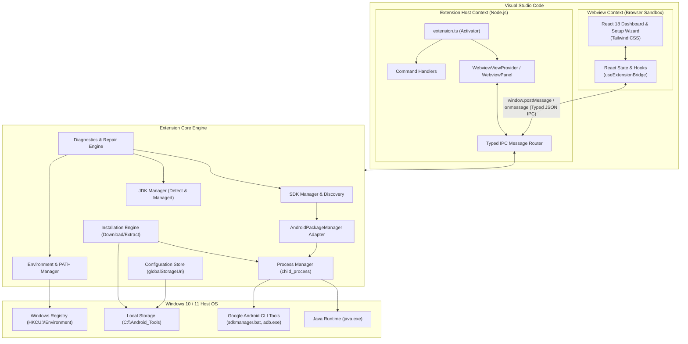

# System Architecture & Technical Design

This document details the software architecture, design patterns, subsystem boundaries, and runtime execution models for **Android Dev Tools**.

---

## 1. Architectural Philosophy & Core Tenets

1. **Dual-Runtime Isolation:**
   - **Extension Host (Node.js):** Owns system I/O, child processes, Windows Registry writes, network requests, and local disk persistence.
   - **Webview UI (Browser Sandbox):** Owns visual rendering, user interaction, state reflection, and form inputs. It is completely isolated from native Node.js APIs (`fs`, `child_process`, `os`).
2. **Adapter Abstraction for Android CLI:**
   - Decouple the application from concrete command-line tool syntax via the `AndroidPackageManager` interface. This allows seamless transitions between classic `sdkmanager.bat` and modern `android sdk` commands without changing the UI or workflow logic.
3. **User-Scope Safety:**
   - No administrator elevation is required. Environment modifications target `HKCU:\Environment` (User scope).
4. **Resilience & Idempotence:**
   - Operations (downloads, extractions, PATH updates) can be halted and resumed. PATH additions are strictly deduplicated and normalized.

---

## 2. High-Level Subsystem Diagram



---

## 3. Subsystem Breakdown

### 3.1 Extension & IPC Layer (`src/extension/`)
- **`extension.ts`:** Entry point for extension activation (`activate`, `deactivate`). Registers commands (`androidDevTools.openDashboard`, `androidDevTools.runDiagnostics`) and initializes the Webview provider.
- **`providers/DashboardViewProvider.ts`:** Implements `vscode.WebviewViewProvider` (sidebar) and `vscode.WebviewPanel` (editor tab) with secure Content Security Policies (CSP), local resource roots, and lifecycle teardown.
- **`messaging/MessageRouter.ts`:** Handles bidirectional JSON-RPC style communication between Webview and Extension Host. Validates incoming message payloads against typed schema definitions.

### 3.2 Core SDK Layer (`src/core/sdk/`)
- **`sdk-discovery.ts`:** Scans standard system locations, inspects current process environment (`ANDROID_HOME`, `ANDROID_SDK_ROOT`), detects installed Android platforms, build tools, `adb.exe`, and `sdkmanager.bat`.
- **`package-manager-adapter.ts`:** Defines and implements the `AndroidPackageManager` interface:
  ```typescript
  export interface AndroidPackageManager {
    listPackages(): Promise<PackageInfo[]>;
    listInstalledPackages(): Promise<PackageInfo[]>;
    installPackages(
      packages: string[],
      onProgress: (progress: InstallProgress) => void
    ): Promise<InstallResult>;
    updatePackages(): Promise<InstallResult>;
    acceptLicenses(): Promise<LicenseResult>;
  }
  ```
- **`package-catalog.ts`:** Parses raw text output from `sdkmanager --list --verbose` into structured TypeScript objects with categories (`cmdline-tools`, `platform-tools`, `build-tools`, `platforms`, `system-images`).

### 3.3 Core Installation Layer (`src/core/installer/`)
- **`installer.ts`:** State machine coordinating multi-step installations (disk check -> download -> checksum verify -> extraction -> SDK initialization -> package installation -> license acceptance -> environment configuration).
- **`downloader.ts`:** Handles HTTP/HTTPS streaming with pause/resume support, progress byte calculation, and incremental SHA-256 digest computation.
- **`extractor.ts`:** Safe archive extraction handling nested zip contents, ensuring Google's required `cmdline-tools/latest` directory layout.
- **`progress.ts`:** Normalizes indeterminate vs determinate progress reporting across downloads and CLI invocations.
- **`recovery.ts`:** Clean-up routines for aborted tasks, removing temporary `.download` artifacts while preserving validated archives.

### 3.4 Core JDK Layer (`src/core/jdk/`)
- **`jdk-detection.ts`:** Probes `JAVA_HOME`, system `PATH`, standard directories (`C:\Program Files\Java`, `C:\Program Files\Eclipse Adoptium`), parses `java -version` output, and validates JDK major version against Android Gradle Plugin requirements.
- **`jdk-installer.ts`:** Automates fetching and extracting certified headless OpenJDK distributions (e.g. Eclipse Temurin 17) to `<install-root>/jdk/managed`.
- **`jdk-manager.ts`:** Strategy router coordinating between Auto-Detect, Managed JDK, and Manual user path configuration.

### 3.5 Core Environment Layer (`src/core/environment/`)
- **`windows-environment.ts`:** Native Windows interaction for persistent user variables:
  - Reading `HKCU:\Environment` via PowerShell / Windows Registry query.
  - Setting persistent variables via `[Environment]::SetEnvironmentVariable(var, val, 'User')`.
- **`path-manager.ts`:** Safe, non-destructive PATH mutation:
  - Splits PATH using `;`.
  - Normalizes drive letters, slashes, and casing.
  - Checks if target paths (`platform-tools`, `cmdline-tools/latest/bin`) are already present.
  - Appends only missing entries without re-ordering existing directories.
- **`environment-manager.ts`:** High-level coordinator that updates persistent Windows registry, synchronizes `process.env` in the current extension host, and alerts VS Code if terminal processes must be restarted.

### 3.6 Core Diagnostics Layer (`src/core/diagnostics/`)
- **`diagnostics.ts`:** Rule-based diagnostic evaluation engine. Checks for common failure modes (missing `adb.exe`, `ANDROID_HOME` pointing to non-existent folder, `JAVA_HOME` version mismatch, unaccepted licenses, PATH omissions).
- **`health-check.ts`:** Individual atomic test probes returning standardized `DiagnosticIssue` objects:
  ```typescript
  export interface DiagnosticIssue {
    id: string;
    severity: 'error' | 'warning' | 'info';
    title: string;
    description: string;
    detectedPath?: string;
    solution: string;
    canAutoFix: boolean;
    autoFixAction?: string;
  }
  ```

### 3.7 Core Process Layer (`src/core/process/`)
- **`process-manager.ts`:** Spawns and supervises native binaries (`powershell.exe`, `sdkmanager.bat`, `adb.exe`, `java.exe`).
  - Uses explicit argument arrays to prevent shell-injection vulnerabilities.
  - Captures and buffers `stdout` and `stderr` streams with event-based lines.
  - Supports cancellation via OS process tree termination (`taskkill /pid <PID> /T /F`).

### 3.8 Presentation Layer (`src/ui/`)
- Built with React 18 and Tailwind CSS.
- **Pages:**
  - `Overview`: Instant health dashboard, active SDK path, component checklist, quick actions.
  - `SetupManager`: Guided 6-step setup wizard with live progress tracking.
  - `Components`: Tabular package catalog showing installed, updateable, and available SDK components.
  - `JDKManager`: Visual Java environment card, version compatibility matrix, and switchers.
  - `Diagnostics`: Interactive health checklist with one-click "Fix automatically" triggers.
  - `Settings`: User configurations, profiles, and persistence overrides.

---

## 4. Local Installation Layout Specification

```
<UserSelectedRoot, e.g. D:\Android_Tools>\
├── sdk\                           # Designated ANDROID_HOME
│   ├── cmdline-tools\
│   │   └── latest\                # Nested structure required by sdkmanager
│   │       ├── bin\               # sdkmanager.bat, avdmanager.bat
│   │       ├── lib\
│   │       └── source.properties
│   ├── platform-tools\            # adb.exe, fastboot.exe
│   ├── build-tools\               # e.g., 34.0.0\, 35.0.0\
│   ├── platforms\                 # e.g., android-34\, android-35\
│   ├── emulator\                  # emulator.exe (Phase 2)
│   ├── system-images\             # System images (Phase 2)
│   └── licenses\                  # Accepted license signature files
├── jdk\
│   └── managed\                   # Managed OpenJDK 17 directory
├── downloads\                     # Temporary holding for downloaded zips
├── logs\                          # Session installation & execution logs
└── config\                        # Component manifests and settings
    ├── settings.json
    ├── installation.json
    └── manifest.json
```

---

## 5. Persistence & Storage Strategy

The extension relies on VS Code's built-in persistence APIs rather than writing unmanaged configuration files across user projects:

1. **`ExtensionContext.globalStorageUri`:**
   - Used for global settings, SDK installation metadata (`installation.json`), and downloaded tool catalogs.
   - Preserved across VS Code sessions and project workspaces.
2. **`ExtensionContext.workspaceState`:**
   - Used for workspace-specific overrides (e.g. if a specific repository requires a custom SDK target or custom JDK version).
3. **Local Managed Config (`<Root>/config/`):**
   - Stores `installation.json` inside the managed root directory so external tools or subsequent extension installs can recognize the managed state independently of VS Code's internal storage.

---

## 6. Security & Isolation Boundaries

- **Input Sanitization:** All user-supplied filesystem paths are normalized, resolved, and verified to ensure they reside on a valid, writable drive.
- **Process Spawning:** Commands constructed from dynamic variables are invoked via `child_process.spawn(executable, argsArray)` without shell wrappers (`shell: false`), disallowing shell metacharacter injection.
- **Webview CSP:** Strictly disallows inline script execution (unless nonce-stamped) and prevents loading arbitrary external remote scripts.
- **No Machine Scope Writes:** Modification of registry is bounded to `HKCU` (Current User), ensuring zero risk to system-critical Windows services.

