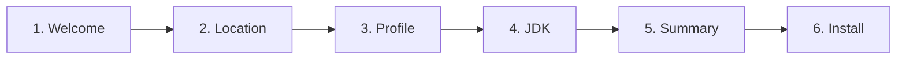

# UI/UX & Webview Frontend Specification

This document details the interface architecture, design system, theme integration, page wireframes, and component hierarchy for the **Android Dev Tools** Visual Studio Code Webview interface.

---

## 1. Design Principles & Theme Integration

1. **Native VS Code Integration:**
   The Webview UI must blend seamlessly into the developer's chosen VS Code theme (Light, Dark, High Contrast). Hardcoded hexadecimal colors for backgrounds and foregrounds are prohibited. All colors bind to VS Code theme CSS variables.
2. **Utilitarian Developer Aesthetic:**
   Avoid heavy decorative illustrations, 3D elements, or superfluous animations. Focus on clear typography, tabular density, immediate status clarity, and rapid task completion.
3. **Responsive Dual-Mode Container:**
   The Webview must adapt flawlessly to two distinct display contexts:
   - **Narrow Sidebar View (`WebviewViewProvider`):** Width 300px - 450px. Vertical stacking, compact cards.
   - **Wide Editor Panel View (`WebviewPanel`):** Width 800px - 1600px+. Multi-column layout with detailed metrics.

---

## 2. VS Code Theme CSS Variable Mapping

Tailwind CSS will be configured with semantic tokens mapped to native VS Code CSS variables:

```css
:root {
  --bg-app: var(--vscode-editor-background);
  --fg-app: var(--vscode-editor-foreground);
  --fg-muted: var(--vscode-descriptionForeground);
  
  --bg-card: var(--vscode-sideBar-background, var(--vscode-editor-background));
  --border-card: var(--vscode-widget-border, var(--vscode-editorWidget-border, #3c3c3c));
  
  --btn-primary-bg: var(--vscode-button-background);
  --btn-primary-fg: var(--vscode-button-foreground);
  --btn-primary-hover: var(--vscode-button-hoverBackground);
  
  --btn-secondary-bg: var(--vscode-button-secondaryBackground);
  --btn-secondary-fg: var(--vscode-button-secondaryForeground);
  --btn-secondary-hover: var(--vscode-button-secondaryHoverBackground);
  
  --input-bg: var(--vscode-input-background);
  --input-fg: var(--vscode-input-foreground);
  --input-border: var(--vscode-input-border);
  
  --status-success: var(--vscode-testing-iconPassed, #4ec9b0);
  --status-warning: var(--vscode-editorWarning-foreground, #cca700);
  --status-error: var(--vscode-editorError-foreground, #f14c4c);
  --status-info: var(--vscode-editorInfo-foreground, #3794ff);
}
```

---

## 3. Main Navigation & Shell Architecture

```
+-------------------------------------------------------------------------+
| [Android Dev Tools]  v0.1.0 (MVP)                                      |
+-------------------------------------------------------------------------+
| [Overview]  [Setup Manager]  [SDK Components]  [JDK]  [Diagnostics] [*] |
+-------------------------------------------------------------------------+
|                                                                         |
|                       <ACTIVE PAGE CONTENT>                            |
|                                                                         |
+-------------------------------------------------------------------------+
```

---

## 4. Page Specifications & Layouts

### 4.1 Overview Dashboard (`src/ui/pages/Overview.tsx`)
The default landing view that immediately answers:
- Is my Android environment ready?
- Where is the SDK installed?
- Which components are missing or broken?

```
+-------------------------------------------------------------------------+
| [!] Environment Warning: Missing ADB in PATH                            |
| 1 issue requires attention. [Review Diagnostics Button]                 |
+-------------------------------------------------------------------------+
| Status: WARNING                                                         |
| Configured SDK: D:\Android_Tools\sdk                                   |
+-------------------------------------------------------------------------+
| [ Quick Metrics Grid ]                                                  |
| +-------------------+ +-------------------+ +-------------------------+ |
| | SDK Tools         | | ADB Binary        | | Java Environment        | |
| | Installed (12.0)  | | Missing from PATH | | OpenJDK 17.0.8 (Valid)  | |
| +-------------------+ +-------------------+ +-------------------------+ |
| | SDK Licenses      | | Build Tools       | | Platforms Target        | |
| | Accepted          | | 34.0.0 (Installed)| | android-34 (Installed)  | |
| +-------------------+ +-------------------+ +-------------------------+ |
+-------------------------------------------------------------------------+
| Actions: [ Run Verification ]  [ Open Setup Wizard ]  [ Fix Environment]|
+-------------------------------------------------------------------------+
```

---

### 4.2 Setup Manager Wizard (`src/ui/pages/SetupManager.tsx`)
A guided 6-step installation wizard for initial configuration or reinstallations.



- **Step 1: Welcome**
  - Explains what Android Dev Tools installs (command-line tools, platform tools, build tools, platforms).
  - Clarifies that no full Android Studio installation is required.
- **Step 2: Installation Location**
  - Path input field with native directory picker button (`SELECT_DIRECTORY`).
  - Real-time disk space analyzer (e.g., `Drive D: 84.2 GB Free - Recommended`).
- **Step 3: Installation Profile**
  - **Physical Device Profile (Recommended, ~2.5 GB):** cmdline-tools, platform-tools, build-tools, android platform.
  - **Full Setup Profile (~12 GB):** Adds Android Emulator & x86_64 System Image.
  - **Custom Profile:** Checkbox selection of specific packages.
- **Step 4: JDK Configuration**
  - Option A: Auto-detect existing system JDK (shows detected version and path).
  - Option B: Install Managed OpenJDK 17 (recommended, isolated in `<root>\jdk\managed`).
  - Option C: Specify manual JDK folder.
- **Step 5: Summary & Confirmation**
  - Detailed pre-flight table: Target path, selected packages, estimated download size, environment variables to be set (`ANDROID_HOME`, `PATH`).
- **Step 6: Live Installation Progress**
  - Multi-stage step tracker (Validating -> Downloading -> Extracting -> Installing -> Finalizing).
  - Real-time progress bar (determinate with % and byte counters when available; smooth indeterminate pulse when unpacking).
  - Collapsible live output log drawer.

---

### 4.3 SDK Components Screen (`src/ui/pages/Components.tsx`)
A package catalog allowing granular management of installed and available Android packages.

- **Header Controls:** Filter tabs (`All`, `Build Tools`, `Platforms`, `System Images`), Search input, `[Refresh Catalog]` button.
- **Package Table Columns:**
  - `Package Name`: e.g. "Android SDK Platform 34"
  - `Identifier`: e.g. `platforms;android-34`
  - `Version / Revision`: e.g. `3`
  - `Status`: `Installed` (green badge), `Update Available` (blue badge), `Not Installed` (gray badge)
  - `Actions`: `[Install]`, `[Update]`, `[Uninstall]`

---

### 4.4 JDK Manager Screen (`src/ui/pages/JDKManager.tsx`)
Dedicated Java environment inspector.
- **Current Active Java Card:**
  - Displays `JAVA_HOME` path and `java.exe` binary version.
  - **AGP Compatibility Indicator:** Explains compatibility (e.g. `Valid for Android Gradle Plugin 8.0+`).
- **Managed JDK Status:**
  - Displays whether `<root>\jdk\managed` is installed.
  - One-click `[Install Managed OpenJDK 17]` button if missing or corrupted.
- **Manual JDK Selector:**
  - Directory picker for custom installations with immediate validation of `bin\javac.exe`.

---

### 4.5 Diagnostics Screen (`src/ui/pages/Diagnostics.tsx`)
The primary self-healing hub for broken development environments.

- **Issue Cards:**
  Each diagnostic issue contains:
  1. **Severity Badge:** `[ERROR]`, `[WARNING]`, `[INFO]`.
  2. **Title:** e.g. *"ADB is not recognized in PATH"*.
  3. **Root Cause Analysis:** *"Detected `adb.exe` at `D:\Android_Tools\sdk\platform-tools\adb.exe`, but this directory is absent from your Windows User PATH variable."*
  4. **Action Buttons:**
     - `[Fix Automatically]`: Invokes Extension Host repair handler.
     - `[Show Manual Steps]`: Opens an expandable step-by-step tutorial.

---

### 4.6 Settings Screen (`src/ui/pages/Settings.tsx`)
Persisted configuration management:
- SDK root directory path override.
- Auto-validation toggle on extension startup.
- Notification preferences.
- `[Reset to Defaults]` and `[Export Diagnostic Log]` buttons.

---

## 5. Accessibility & Interaction Specifications

1. **Keyboard Navigation:**
   All buttons, inputs, and interactive cards must support standard tab stops (`tabindex="0"`) with visible focus outlines (`outline: 2px solid var(--vscode-focusBorder)`).
2. **Aria Attributes:**
   - Wizard steps utilize `aria-current="step"`.
   - Progress indicators provide `role="progressbar"` with `aria-valuenow`, `aria-valuemin="0"`, and `aria-valuemax="100"`.
   - Modals utilize `role="dialog"` with trapped focus and `Escape` key listeners.

