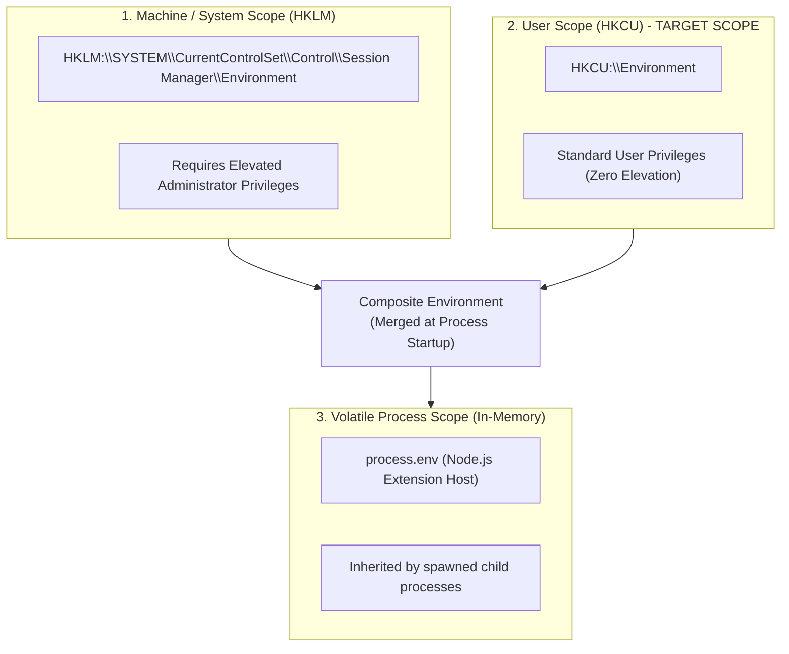

# Windows Environment Management & System Integration Guide

This document is the engineering reference for manipulating Windows environment variables, registry hives, and path resolutions safely and non-destructively within **Android Dev Tools**.

---

## 1. Environment Variable Architecture on Windows

Windows partitions environment variables into three distinct scopes:



### Critical Architectural Policy
**All persistent environment variable mutations performed by this extension MUST target User Scope (`HKCU:\Environment`).**
- Never write to Machine Scope (`HKLM`). Writing to `HKLM` requires an administrative UAC prompt, which violates the frictionless user experience and risks clobbering system-critical variables.

---

## 2. Canonical Android Variables & Actions

| Variable | Action | Canonical Value Pattern | Notes |
|---|---|---|---|
| `ANDROID_HOME` | **Create or Update** | `<install-root>\sdk` (e.g. `C:\Android_Tools\sdk`) | Canonical standard recognized by modern Gradle, AGP, and CLI tools. |
| `ANDROID_SDK_ROOT` | **Reconcile / Preserve** | Must match `ANDROID_HOME` if present | Google deprecated this variable. If it exists and differs from `ANDROID_HOME`, flag as a conflict and offer reconciliation. |
| `JAVA_HOME` | **Conditional** | `<install-root>\jdk\managed` or detected path | Set only if the user opts into the Managed JDK or explicitly instructs the extension to override their Java path. |
| `PATH` | **Surgical Append** | Appended with required subdirectories | Add missing paths only. Never overwrite the entire variable. |

---

## 3. Persistent User Variable Management via PowerShell & .NET

To ensure atomic and reliable persistence on Windows, the extension utilizes the native .NET `System.Environment` API invoked through PowerShell or Node.js Windows registry bridges:

### 3.1 Reading User Variables
```powershell
[System.Environment]::GetEnvironmentVariable('ANDROID_HOME', [System.EnvironmentVariableTarget]::User)
```

### 3.2 Setting Persistent User Variables
```powershell
[System.Environment]::SetEnvironmentVariable(
    'ANDROID_HOME',
    'C:\Android_Tools\sdk',
    [System.EnvironmentVariableTarget]::User
)
```

> **Under the Hood:** Calling `[System.Environment]::SetEnvironmentVariable(..., 'User')` writes directly to `HKEY_CURRENT_USER\Environment` and automatically broadcasts a `WM_SETTINGCHANGE` message (`lParam = "Environment"`) to top-level Windows desktop windows, notifying running processes that environment definitions have changed.

---

## 4. Surgical PATH Mutation Strategy

Blindly overwriting or prepending to `PATH` is a major cause of broken development machines. The `PathManager` module implements a non-destructive algorithm:

```mermaid
flowchart TD
    ReadRegistry[1. Read raw User PATH from HKCU:\\Environment] --> SplitEntries[2. Split string on ';']
    SplitEntries --> FilterEmpty[3. Filter empty strings & trim whitespace]
    FilterEmpty --> NormalizeList[4. Normalize each path: resolve slashes, lower-case for comparison]
    
    NormalizeList --> LoopTarget[5. For each required path: platform-tools, cmdline-tools\\latest\\bin]
    LoopTarget --> CheckExists{Is target path already in normalized list?}
    CheckExists -- Yes --> Skip[Skip - Already configured]
    CheckExists -- No --> Append[Append target path to list]
    
    Skip --> NextTarget{More targets?}
    Append --> NextTarget
    NextTarget -- Yes --> LoopTarget
    NextTarget -- No --> CheckLength{Is total PATH length < 2048 chars?}
    
    CheckLength -- No --> Error[Throw ERR_PATH_TOO_LONG with warning]
    CheckLength -- Yes --> Commit[6. Write back to HKCU:\\Environment via [Environment]::SetEnvironmentVariable]
```

### Required Subdirectories to Add to PATH:
1. `%ANDROID_HOME%\platform-tools` (provides `adb.exe`, `fastboot.exe`)
2. `%ANDROID_HOME%\cmdline-tools\latest\bin` (provides `sdkmanager.bat`, `avdmanager.bat`)
3. `%ANDROID_HOME%\emulator` (optional, added only when emulator package is installed)

### Deduplication Algorithm (TypeScript)
```typescript
export function appendToPathIfMissing(currentPath: string, newEntries: string[]): { updatedPath: string; changed: boolean } {
  const delimiter = ';';
  const existingEntries = currentPath
    .split(delimiter)
    .map(e => e.trim())
    .filter(e => e.length > 0);

  const normalizedExisting = new Set(
    existingEntries.map(e => path.normalize(e).toLowerCase().replace(/[\\/]+$/, ''))
  );

  const toAdd: string[] = [];

  for (const entry of newEntries) {
    const normalizedTarget = path.normalize(entry).toLowerCase().replace(/[\\/]+$/, '');
    if (!normalizedExisting.has(normalizedTarget)) {
      toAdd.push(entry);
      normalizedExisting.add(normalizedTarget);
    }
  }

  if (toAdd.length === 0) {
    return { updatedPath: currentPath, changed: false };
  }

  const updatedEntries = [...existingEntries, ...toAdd];
  const updatedPath = updatedEntries.join(delimiter);

  if (updatedPath.length > 2048) {
    throw new Error('User PATH exceeds safe limit of 2048 characters.');
  }

  return { updatedPath, changed: true };
}
```

---

## 5. The VS Code Process Boundary & In-Memory Propagation

### 5.1 The Inherited Environment Problem
When a developer launches VS Code, the main VS Code process inherits a snapshot of the Windows environment at that exact moment. Any integrated terminal, task runner, or Extension Host spawned by VS Code inherits that initial process environment.

**Updating `HKCU:\Environment` does NOT retroactively mutate the memory space of existing processes.**

### 5.2 Two-Stage Synchronization Solution
1. **In-Memory Extension Host Update:**
   Immediately after writing to the registry, the extension synchronizes its own runtime environment:
   ```typescript
   process.env['ANDROID_HOME'] = newSdkRoot;
   process.env['PATH'] = `${process.env['PATH']};${newEntries.join(';')}`;
   ```
   This ensures that any subsequent CLI commands spawned by the extension host (`sdkmanager.bat`, `adb.exe`) execute successfully during the same session.
2. **User Notification for External Terminals:**
   External command prompts and already-open integrated terminals in VS Code will not see the new variables until a new terminal is created or VS Code is reloaded. The extension displays an informative notification:
   > *"Android development environment configured successfully. To use `adb` or `sdkmanager` in your integrated terminal, please open a new terminal window or run `Developer: Reload Window`."*

---

## 6. Fresh Process Verification

To mathematically prove that environment configuration succeeded in the real OS (outside the Extension Host's in-memory state), the diagnostic engine executes an out-of-process verification check:

```typescript
export async function verifyEnvironmentInFreshProcess(): Promise<boolean> {
  return new Promise((resolve) => {
    // Spawns a clean cmd.exe instance which reads User/System environment fresh
    const proc = child_process.spawn('cmd.exe', ['/c', 'adb', 'version'], {
      windowsHide: true,
      env: undefined // Forces default fresh process inheritance where supported
    });

    proc.on('close', (code) => {
      resolve(code === 0);
    });

    proc.on('error', () => {
      resolve(false);
    });
  });
}
```

